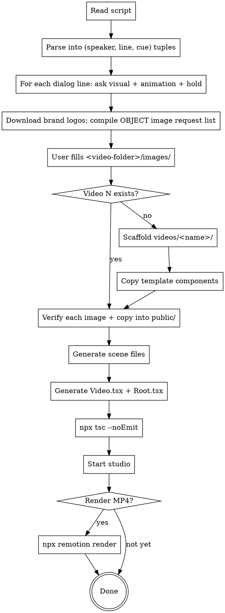

## Step 0 — sync shared learnings (before anything else)

Run this first, every single time this skill is invoked:

```bash
D=~/.claude/office-skills; [ -d "$D/.git" ] || git clone -q --depth 1 -b learnings --single-branch https://github.com/CodeYogiOrg/skills.git "$D"; bash "$D/scripts/sync.sh" create-video video-pack
```

It pulls the `office-skills` repo and prints every learning pushed for this skill
since anyone last ran it. **Obey what it prints.** Where a learning and this file
disagree, the learning wins — it is newer by definition.

If it fails (offline, no repo access), say so in one line and carry on. A sync
problem must never block the work.

To push a learning back so the whole office gets it:
`bash ~/.claude/office-skills/scripts/learn.sh create-video "the rule"`

---

# Create Video

Turn a <script>.md into a working Remotion video by asking one question per dialog line. Transitions are standardized (seamless content swap — never crossfade two scenes). Images split by kind: **brand logos are downloaded automatically** (a logo is a logo — it never varies), while **object/photo images are supplied by the USER** (they're variable — style, angle, model are his call): at the end of animation planning, send one consolidated object-image request list; the user drops the files into the `images/` folder inside the video title folder (same place as the audio folder), and scenes use them from there.

**The screen is never dead.** Every second of voiceover has something happening: word-anchored animations where planned, and a karaoke `SubtitleScreen` (each sentence shows whole in grey, letters deepen to the main blue in sync with the voice — see `subtitle-screen` skill) wherever a long line has no animation. Interactive always, distracting never.

**Show the REAL thing, never an abstract placeholder (settled 2026-07-29).** Whenever the narration names on-screen content — "text", "photo", "image", "button", "logo", "search bar", a heading — render the actual thing, not a grey bar / colored rectangle / triangle-in-a-box standing in for it. "har photo, har text, har button, har image" → a real photo, real words, a labelled button, a real image on a real webpage mock (with a plausible address in the bar). Real TEXT and BUTTONS you write directly; brand LOGOS download automatically; PHOTOS/IMAGES either come from the user OR you generate them yourself on a cheap OpenArt image model (nano-banana-2-lite / seedream-5-lite, ~15 cr) into `public/images/` — the author is fine with you generating these rather than requesting them when the user says so. Placeholder blocks read as "unfinished".

## When to use

- User points to a script file (usually `<script>.md`) and says "make this a video" / "create a remotion video from this"
- User invokes `/create-video <path>` or references this skill by name (it was called `remotion-from-script` until 2026-10-15)
- User wants dialog-by-dialog control over what appears on screen

**Do NOT use when:**
- User already has a Remotion project and just wants to edit an existing scene → edit the scene file directly
- User wants a Google Vids segment breakdown → use `vids` skill
- User wants a HyperFrames video → use `hyperframes` skill

## Project profile — NOTHING is assumed (settled 2026-10-15)

*"The API key should be provided — it should not be given like this. No the character, no
ElevenLabs. The user will also select whether there will be a character or not, and
whether that character will lip-sync or not. Manage all these things in the skill."*

This skill ships **no character, no voice vendor and no API key**. Every video
answers the profile questions in **step 0** before anything is read or built, and
the answers are written to `videos/<name>/video.config.json` so a later session
(or a re-render) never re-guesses. Presets exist so a repeat project is one answer,
not five — but a preset is something the user PICKS, never a default that happens.

### Keys belong to the user, always

No skill in this pipeline stores, bundles or reads a key from its own directory.
Every provider script takes its key from an environment variable the user sets and
**fails loudly with the exact variable name and `export` line when it is missing**
(`ELEVENLABS_API_KEY`, `HEDRA_API_KEY`, …). There is a `.env.example` in each
provider skill naming the variable and holding no value.

- **Never** write a key into a skill folder, a template, a `voices.json`, or a
  committed `.env`. Never echo a key into the transcript.
- If a step needs a key the user has not set, STOP and show the `export` line.
  Do not offer to put the key in a file, and do not fall back to another vendor.
- A provider the user has no key for is simply not on the menu — offer the
  no-key routes (user-supplied audio, user-supplied clips, the local rig) instead.

### Character presets

| Preset | Character | Lip-sync route | Voice |
|---|---|---|---|
| `ai-builder-course` | the character (green-screen clips) | supplied clips, else a configured talking-head API | ElevenLabs, fixed the script's speakers voices |
| `narrator-only` | none | n/a | whatever step 0 picks |
| *(custom)* | user's asset | user's choice | user's choice |

the character and ElevenLabs live ONLY in the `ai-builder-course` preset. Picking any
other profile must leave no trace of either in the generated project.

## Output shape

One folder per video, sibling to any existing HyperFrames video folder:

```
videos/<name>/
  src/
    Root.tsx                 ← registers composition (1080×1920, 30fps)
    Video.tsx                ← main composition, stitches scenes with transitions
    scenes/
      scene-01-<slug>.tsx    ← one file per dialog line
      scene-02-<slug>.tsx
      ...
    data/
      subtitle-<line>.ts     ← whisper word-timing arrays for SubtitleScreen stretches
    components/              ← reusable primitives (copied from skill template)
      PaperBackground.tsx
      Caption.tsx
      DeviceFrame.tsx        ← Phone + Laptop
      SceneInOut.tsx         ← seamless content-swap wrapper (every scene uses it)
      DipToBlack.tsx         ← dark-out/dark-in overlay — NOT used by default (only on explicit request)
      BrandLogo.tsx          ← real transparent PNG logos from public/logos/
      Logo.tsx               ← simple-icons fallback + TileLogo for letter-tiles
      Character.tsx              ← character stand-in
      PopIn.tsx              ← spring entrance at a word frame, element stays in its layout slot
      SubtitleScreen.tsx     ← karaoke subtitles — copied from the subtitle-screen skill's template (its canonical home)
      Sfx.tsx                ← frame-anchored UI sound (cuelume WAV via <Audio>)
      timeline.ts            ← buildTimeline(SCENES): derived absolute frames — no hand arithmetic (step 3c)
  ../scripts/                ← SHARED automation tools at videos/scripts/ — ONE copy for all videos, never per-project (restore from <skill-dir>/template/scripts/ if missing)
    transcribe.mjs           ← audio → typed src/data/*.ts word-timing file + speech-span/gap report (step 3b)
    prep-character.mjs           ← the character clip → silencedetect trim math + keyed WebM + paste-ready mount numbers (step 5d)
    prep-music.mjs           ← track → leveled, seamlessly looped, −30 dB music bed + continuity verify (step 5e)
    render.mjs               ← auto-versioned render — finds the next -vNN, never overwrites (step 9)
    lint-norms.mjs           ← checks the settled rules (no PaperBackground in scenes, PopIn↔Sfx pairing, …) before rendering (step 8)
    gen-sfx.mjs              ← renders cuelume + custom sound recipes offline to public/sfx/*.wav (WAVs ship pre-rendered in the template — rerun only for NEW recipes)
    gen-music.mjs            ← synth fallback ONLY — real royalty-free track is the standard (see music bed section)
  public/
    audio/                   ← section mp3s (copied from <video-folder>/audios/) + music-bed.wav
    <char>/                  ← chroma-keyed character WebMs — KEPT assets, never re-processed (step 5d)
    logos/                   ← transparent brand logos — common ones ship PRE-VERIFIED in the template; download only what's missing
    objects/                 ← user-supplied object photos, copied from <video-folder>/images/
    sfx/                     ← UI sound WAVs — ship PRE-RENDERED in the template (deterministic); rerun gen-sfx.mjs only for new recipes
  out/
    video-N.mp4              ← final render
```

**Format defaults (match the reference video style):**
- Vertical 1080×1920 @ 30fps (9:16 reels)
- Warm beige paper background (`#D9C5A3`) — rendered ONCE in Video.tsx, never per scene
- Big bold black centered captions at top
- Real full-color brand logos (transparent PNGs in `public/logos/`, via `<BrandLogo>`) — downloaded automatically; `simple-icons` only as fallback. Object photos come from the user.
- Transitions: seamless content swap everywhere — including `##` section boundaries (whoosh-marked, v27 standard); dip-to-black only if the user explicitly asks
- **On-screen TEXT requires explicit approval (a settled rule, 2026-07-22, refined same day): the ONLY text allowed in a scene is text inherent to a visual the user approved during animation planning — dialog words shown verbatim (karaoke subtitles, an emphasis moment on a spoken phrase), term cards the user chose, labels the user himself described in his answer. NEVER invent anything beyond that: no headings, no titles, no card names, no decorative labels, no captions the user didn't ask for.** When an approved visual carries text, confirm its exact wording in the planning recap; anything not in an approved visual simply doesn't render.
- Every on-screen action carries a subtle UI sound (cuelume-generated WAVs via `<Sfx>`, step 5e) — natural interface sounds only, never quirky/unusual ones

## v27 vocabulary — the canonical terms (settled 2026-07-30)

`videos/video-1` (final render `out/TestVideo-with-sounds-v27.mp4`) is the REFERENCE implementation — when in doubt about any pattern, read its `src/`. These terms are the fixed vocabulary for all future videos; use them in planning questions, comments, and commit messages so every conversation means the same thing:

| Term | Meaning |
|---|---|
| **content swap** | The only scene transition: outgoing content fades out onto clean paper, incoming fades+rises in (`SceneInOut`). Never a crossfade of two scenes. |
| **whoosh boundary** | Scene boundary marked by a `whoosh` SFX at `boundary − 4` — only where the incoming scene has no entrance sound of its own. |
| **word anchor / anchor map** | A visual keyed to the whisper timestamp of the word that names it; the map lives as a comment in the scene file. |
| **karaoke subtitle** | `SubtitleScreen` stretch: sentence whole in grey, letters deepen to `#14306E` in sync with the voice. The fill IS the animation. |
| **reading window** | The ≥1s a finished subtitle/visual stays fully readable before its exit fade (reading scenes only; demo/the character tails stay tight ~18f). |
| **split mount / inserted silence** | Splitting a section-audio MOUNT (`endAt` + second `<Sequence>` with `startFrom`) to insert silence at a handoff — the mp3 file is never edited. |
| **address bridge** | An opening address ("Beta the character, …") mounted ~0.2s after the character's last word, INSIDE his scene, bridging his fade-out. Addresses are never shown as text. |
| **the character hold** | The SAME clip's real silent tail continuing to play under the next audio — one mount, no cut, no loops/freezes/other clips. |
| **speech windows** | Absolute-frame spans where anyone speaks — drives music ducking (full 0.9 → ducked 0.35, 12f ramps). Inserted-silence gaps stay FULL. |
| **kept asset** | A processed file that is never re-generated on later renders: keyed the character WebMs, the music bed, SFX WAVs. Re-process only when the source changes. |
| **dead screen** | Any stretch of voiceover with nothing happening on screen — banned; filled by animation or karaoke subtitle. |
| **dead air** | Audible silence BETWEEN dialog lines caused by padding scene tails past the recording's own pause — banned (settled 2026-07-30). A teacher-chain audio mount runs CONTINUOUSLY across scene cuts (one `<Sequence>` spanning several scenes, `endAt` at the next speaker-turn, not per-line), so the only gap between lines is the take's own breath. Insert silence ONLY where a cut genuinely needs it: exit-fade room before a the character scene (~+12f), a karaoke reading window (~+16f), or a src pause too short for the fade. Wait where the content needs a beat; never merely because scenes are separate files. |

Finalized motion constants (v27 — do not re-tune per video): `SceneInOut` enter 12f fade+rise 30px (cubic-out), exit 10f (cubic-in) fully invisible 2f before the cut, `exit={0}` = hold content to the very last frame; `PopIn` spring damping 14 / stiffness 160, opacity in over 6f; paper = `#D9C5A3` + fractal-noise grain at 0.35 opacity (the texture is part of the look, not just the flat color).

## Workflow



## Plan-file mode — when the folder has a plan.json (from the Video Planner UI)

Non-tech users fill the form at `tools/video-planner/` (`npm start` → http://localhost:4321). It saves `scripts/<name>/` with `script.md`, `plan.json`, `Audios/`, `<char>/`, `images/`. When the user says "build the video from scripts/<name>" and `plan.json` exists:

- **Skip ALL AskUserQuestion planning** — every dialog's choice is in `plan.json`: `preset` (`subtitle` / `mixed-subtitle-device` / `phone` / `laptop` / `browser` / `objects` / `logogrid` / `blank`), `subtitleText` (exact on-screen subtitle text), `icons[]` (brand names → download logos as usual), `sites[]`, `objects[{image, word}]` (user-uploaded, anchor word chosen), `device`, and per-character-dialog `characterVideo` (green-screen clip → step 5d pipeline).
- Section audio path is in each section's `audio`. Transcribe and apply every norm exactly as in interactive mode (word anchors, no dead screen, sequential handoffs, silence insertion, the character trim).
- Ask the user ONLY about things genuinely missing from the plan (e.g. a section with Teacher dialogs but no audio file).

## Step-by-step

### 0. Project profile — ask FIRST, before reading the script

If `videos/<name>/video.config.json` already exists, READ IT and skip this step —
say which profile is in force in one line and move on. Otherwise ask all of it in
**one** `AskUserQuestion` call (offer the matching preset as the first option on
each question when the repo already has videos built from one):

**Q1 — Is there a character on screen?**
- `No character` — narration over visuals only. Skips 5d entirely, and the
  generated project gets no character component, no chroma-key script, no
  `public/<character>/` folder. (`videos/video-ai-works` is this shape.)
- `Yes, a character` — continue to Q2.

**Q2 — (only if Q1 = yes) Does the character's mouth move with the words?**
- `No lip-sync` — a still or lightly animated character (blink, sway, pop-in).
  The voice is a separate narration track. Cheapest, no video pipeline at all.
- `Yes — I supply the talking clips` — the user drops recorded or
  externally-generated clips into `<video-folder>/<character>/`. No API, no key.
  **If the user supplies clips, they WIN over anything generated.**
- `Yes — generate them from an API` — ask WHICH talking-head service, then
  check its key is exported before promising anything (see *Keys belong to the
  user*). Hedra is the known-good route and has its own skill.
- `Yes — local mouth-flap rig` — no network, no key: a weighted random 3-state
  mouth flap driven by the audio envelope, over the user's character art. Cruder
  than real lip-sync and that is the trade the user is accepting.

**Q3 — Where does the voice come from?**
- `I supply the audio` — user drops files in `<video-folder>/audios/`. No key.
- `Generate with a TTS provider` — ask WHICH, then require its env var. The
  `elevenlabs-audio` skill is one such provider, not the default.
- `No voice` — music/SFX only; every line becomes on-screen text.

**Q4 — only if Q1 = yes and the repo has no preset:** which character asset, and
what are the speaker names in the script? (The parser in step 1 keys off them —
do NOT assume `Teacher`/`the character`.)

Write the answers before building anything:

```json
// videos/<name>/video.config.json
{
  "preset": "custom",
  "character": { "enabled": true, "name": "Robo", "asset": "images/robo.png",
                 "lipSync": "supplied-clips", "clipsDir": "robo" },
  "voice": { "source": "tts", "provider": "elevenlabs", "envVar": "ELEVENLABS_API_KEY" },
  "speakers": ["Teacher", "the character"]
}
```

`character.lipSync` is one of `none` | `supplied-clips` | `api` | `local-rig`, and
is meaningless when `character.enabled` is false. Every later step reads this file
rather than assuming: step 1 parses the script against `speakers`, step 4 copies a
character component only when `character.enabled`, step 5d runs only for the chosen
`lipSync` route, and the voice step calls the chosen provider or nothing at all.

**Do not ask these again later in the run.** If the user changes their mind, update
`video.config.json` and say which steps that invalidates.

### 1. Read and parse the script

Read the entire script file. Extract dialog blocks. Each block is:

```
<!-- visual cue as HTML comment (optional) -->
**Speaker:** dialog text
```

Speakers are `Teacher` or `the character`. Multiple dialog paragraphs may share one visual cue.

Determine video number from filename: `Video-1-Script.md` → `N=1`. If ambiguous, ask user.

Ask user upfront: **full script, or just one section (OPENING / etc.)?** Sections in the script use `##` markdown headings. When sections are titled `Section 1`, `Section 2`, ... each section has ONE continuous audio file, and where it comes from was already settled in step 0 by `voice.source`: the user's own files in `audios/`, the TTS provider the user named (his key, his environment), or nothing at all when `voice.source` is `none`. Do NOT re-ask, and do NOT reach for a provider the profile did not choose. See step 3c for how one clip drives many lines.

### 2. Ask per dialog line — visual + animation + hold, in ONE call

**Every single dialog line gets its own AskUserQuestion call — NEVER one question for a whole section**, even when the section shares one audio file. Each call bundles up to three questions:

1. **Visual** — `Line N: [Speaker] "<full line>". What should be on screen?` **Quote the ENTIRE dialog sentence verbatim in the question text — never truncate, summarize, or paraphrase it (the author re-affirmed 2026-07-24). ALSO print the full line verbatim in the plain-text message right before the AskUserQuestion call** — question boxes can clip long text, the message text is the reliable place the user reads it. The user decides what goes on screen by reading the exact words; a shortened line hides the moments that need visuals. Options:
   - **Whatever the HTML comment says** (recommended if there is a cue) — pre-filled from the comment
   - **A concrete alternative** you suggest (based on line content)
   - **Karaoke subtitle screen** — the sentence shows whole in grey and colors in with the voice (`SubtitleScreen`, see `subtitle-screen` skill). **Make this the recommended option when the line is long and has no natural animation** — a conversational line, an explanation with nothing nameable to show, a question with no props. Detect it yourself: no brands/objects/devices named, or the audio clip runs several seconds past the last plannable animation.
   - **Same as previous line** (continuity between adjacent lines)
   - User picks "Other" for free-text
2. **Animation** — how the elements come in: pop on their spoken word (recommended when audio exists) / fade in together / slide in / other
3. **Hold & exit** — what happens after the line's last word: hold everything until the line segment ends (recommended) / carry these elements into the next line / clear early

Duration is asked (3s / 5s / 8s / custom) **only when NO recorded audio exists** for the line — with audio, timing comes from the transcript (steps 3b/3c) and duration questions are skipped.

**One AskUserQuestion call per dialog line.** Do not batch lines — the user needs to think through each moment one at a time.

### 2b. No dead screen — SubtitleScreen fills every animation gap

The screen must ALWAYS be doing something in sync with the voice. Rank each moment of voiceover:

1. **Animation exists for this stretch** → show the animation (word-anchored pops per 3b).
2. **No animation for this stretch** (a long line where the screen would just hold a static frame while the voice keeps talking) → use `SubtitleScreen` for that line: the sentence shows whole in grey and its color fills with the voice, word-timed to the audio. The karaoke fill IS the animation.

**This applies WITHIN a dialog line too, stretch by stretch — not just to whole lines.** Split each line at its animation boundaries and rank every stretch separately. A line like "Beta the character, hum jo apne phone pe alag alag apps use karte hain — unhe hi software kahte hain. WhatsApp, YouTube, Instagram — ye sab apps software hain." has NO animation for the first sentence and word-anchored pops in the second. Wrong: show the phone frame from the start and let it sit idle through the first sentence. Right: run the first sentence as a karaoke subtitle stretch, bring the phone frame in at the END of that stretch (just before its first animated element), then pop the icons on their words and hold.

**Scene-setting frames (phone, laptop, browser) enter just before their first animated element — never earlier.** A device frame sitting on screen with nothing happening inside it IS a dead screen.

**Subtitle→animation handoff is SEQUENTIAL, never overlapping.** When a subtitle stretch finishes:
1. The finished text HOLDS ~1 second — ONLY if the audio has a real gap there (next line/section starts later). The hold must never delay the dialog.
2. The text is removed completely — fast fade, ~10 frames, down to nothing.
3. Only THEN does the next visual enter (device frame fades in / element pops).

The incoming visual must never appear over still-visible text — no crossfading the two layers, nothing "behind" anything.

**The ≥1s reading window is MANDATORY (a settled rule, 2026-07-24 — supersedes the 2026-07-21 "never insert silence" rule).** After a subtitle/visual's dialog completes, it must stay fully readable for AT LEAST 1 second before its exit fade — "the user gets a little window to understand what is written". When the recording's natural gap to the next line is shorter than that, SPLIT the section-audio MOUNT at the boundary (`endAt` + a second mount with `startFrom` — the mp3 file itself stays untouched) and insert the missing silence: text holds 1s, fast exit fade (~7–10f), THEN the next line's audio resumes as its scene enters. This applies at scene boundaries AND at in-scene handoffs (subtitle → stamp moment, e.g. the wait before an "AI" stamp). Only skip the insertion when the natural pause already gives the full 1s.

**The 1s hold is for READING scenes only — keep everything else tight (settled 2026-07-29).** The ≥1s window exists so the viewer can READ a subtitle/karaoke stretch; give it the full ~1s. But animation/demo scenes and the character clips do NOT need a full second of dead tail — after their last word, trim to a short tail (~18f / 0.6s incl. fade) and cut. A full ~1s dead hold on EVERY scene makes the whole video feel slow. And there must be NO extra gap after the cut: the next scene's dialog starts immediately as it enters (audio mounts at the scene's f0 / ~+6f) — the only silence between two dialogs is the outgoing scene's short hold, never a hold PLUS a lead-in on the incoming scene. As originally put: "after the screen change the next dialog should start immediately — that gap seems absurd."

**New-term color emphasis in karaoke subtitles (settled 2026-07-24): ONLY when the author explicitly asks for it on a specific line, a newly-introduced term (e.g. code/coder/coding) renders in a distinct color at its FIRST occurrence in the subtitles — every later occurrence is normal subtitle text. NEVER apply this emphasis on your own; the user will name the lines/terms that get it.**

**Opening addresses are NEVER rendered as subtitle text (v27 standard).** When a line opens by addressing the audience or a character — "बच्चों,", "Beta the character," — the address plays in the audio but is omitted from the on-screen words: the subtitle starts at the first content word (v27 section-1 hides "बच्चों," 0.0–0.58s; the the character case is the address bridge, step 5d). Note the omission in the data file's comment.

**Subtitle text punctuation (settled 2026-07-16): subtitle text NEVER ends with a comma.** If the subtitle ends where a sentence actually ends, close it with a purnaviram (।). If the subtitle stretch cuts off mid-sentence (fade-out on a bridge word), strip the trailing comma and end with no punctuation at all. Mid-text commas are fine.

Flag these gaps DURING planning, not after: when part of a line's clip has nothing new appearing, recommend the karaoke subtitle screen for that stretch in the line's question (step 2, option 3). A static screen-hold over running voiceover is banned — it reads as frozen. But never stack both at full strength either: a stretch is either animation-driven or subtitle-driven (a small word-anchored visual popping beside the subtitle text is fine; a full animated scene under the subtitle text is distracting).

### 2c. Pacing, on-screen questions, and zooming the UI (settled 2026-10-14)

Settled on the AI-works intro review; they apply to every video.

- **Never slow the narration down, and never pad every line with a ~1s gap.** That video ran the voice at `atempo=0.90` with a 0.95s silence after each of its 21 lines — a sixth of the runtime was silence — and his note was *"the overall video pacing needs to increase a bit, it's too slow."* Keep the delivery at the speed it was recorded/generated and put **~0.4s** between lines. Lines that write text on screen are the one exception: they get ~0.85s so the last word can be read (and the scene's exit fade must sit INSIDE that gap, not start while the last word is still being spoken).
- **A question asked to the viewer goes on screen as text.** *"When the video begins the question should pop in as text on the image so that the viewers also know what the question is… and the last question that's asked, also put it up as the text on screen."* Write it word by word, each word on its own spoken frame (the same word map the lip-sync/karaoke uses) — never the whole sentence at once. This does NOT loosen the "on-screen text needs approval" rule: it is the narration's own words, verbatim, which is what makes it allowed.
- **Say it in the language the narration says it in.** On-screen wording follows the voice: the line says "options", so the card reads **`3 options`** — not `३ विकल्प`. Numerals are Roman digits (`3`), never Devanagari (`३`), even in Hindi text.
- **When a screen recording / app screenshot is up and the narration names a feature, the camera MOVES — it does not sit on a static full-device shot.** *"Whenever something is shown on the mobile screen, the UI and some feature are being talked about — zoom in on the video and zoom in on the mobile screen and show the UI change that's happening."* The pattern (see `videos/video-ai-works/src/components/Visuals.tsx` → `AppShot`): open wide on the whole device → push in on the control at the frame of the word that names it → at the moment the narration describes the result, cross-fade to the "after" screenshot while the camera travels to wherever the change shows, and hold there. The clipping window closes down vertically as it pushes in, or a short wide control ends up framed in half a page of blank app.
- **A highlight the viewer cannot read is not a highlight (settled 2026-10-15).** *"The highlights of the UI screen are pathetic — it is inconsistent and what is being highlighted is not visible on the screen. Zoom in on what's being highlighted and make sure it is in the correct order."* This SUPERSEDES the earlier "keep the whole phone on screen and blur around the control" instruction: at a phone height of ~820px in a 1920 frame a button is ~40px tall, and no amount of blur or ring makes 40px readable. The camera must actually travel INTO the control. Size the move off the box — pick the scale that makes the padded box fill ~80% of the window's width or ~50% of its height, whichever binds — and cap it (~2.4x) because past that the device is so much wider than the window that the shot stops reading as a phone. Let the window itself gain a rounded edge and a faint rim as the camera pushes in, so the crop reads as a deliberate close-up rather than a picture that got cut off. With a real zoom the blur-and-punch-a-hole machinery is redundant: delete it, keep the ring.
- **The camera must ARRIVE on the word, not leave on it.** A zoom takes frames to travel (~26), so `zoomAt` is *the naming word minus the travel time*, and the second ring's `swapAt` is *the result word minus the ring's own delay*. Cue values copied from a version where the camera barely moved will all fire late. When a scene has no second target, pull the camera back out to the whole device after the click instead of holding a close-up on a button — a held close-up with nothing happening is a dead screen.
- **Zoom mechanics that matter:** drive the move with layout `width`/`height`/`left`/`top`, NOT a CSS `transform: scale` — a transformed layer is rasterised once and stretched, so the zoom goes soft. Pre-upscale screenshots 3× (`scale=iw*3:ih*3:flags=lanczos,unsharp=5:5:0.5:5:5:0`) so the browser never interpolates past 1:1. And if the project loads Tailwind, set `maxWidth: "none"` on the image — Preflight's `img { max-width: 100% }` silently clamps a zoomed shot to the window width and the picture slides off-frame while the highlight ring stays put.
- **An explainer adapted from a reference video gets the reference's intro page.** *"I also want the intro page as the characters dancing that was in the reference video."* When a video is a port/adaptation, re-check the reference's opening before deciding it has none — a title card that got cut during the build is not a settled decision. The AI-works pattern: arcade title card in the upper half, a row of the reference's own characters dancing under it (spaced by CENTRE so they can be large — a sprite fills about half its source box), host below, ~3.5s, short dip-in so the entrance is visible. **If the dancers move to music, measure the track's BPM** (autocorrelate the onset envelope) and set the sprite BPM to it — dancers on a stale BPM read as off-beat against the bed.
- **A screenshot the author hands you WINS, and it goes exactly where the user says.** *"I am giving screenshots, use them in the places I will tell."* He names the moment ("the Start over button, top left") and supplies the image; drop it in at that moment, replacing whatever stand-in is there — a frame pulled from a recording is only a guess and is frequently the WRONG screen. Then **re-measure the scene's focus box against the new shot** (the old box points at the old picture's geometry) and keep the stand-in under an honest name rather than deleting it. Verify with a `remotion still` at the frame the word is spoken, viewed with Read, BEFORE the full render.
- **A second language is a PROP, never a second folder.** *"Now make the full English version — English labels and audio."* Fork the project and every later fix lands twice; the two versions drift and the second one quietly rots. Instead: give every build script a `--lang` flag (no flag = the original language, so no existing command changes meaning), write each artefact's twin beside the original (`audios-en/`, `public/audio/en/`, `src/data/*-en.ts`), collect labels + the data bundle in ONE module (`src/lang.tsx`: strings, the face to set them in, timeline, word map, lip-sync envelope, audio paths), and register a second `<Composition>` whose `defaultProps` pick the language. Components then read `useS()` / `useLang()` and nothing imports `src/data/*` directly. The scenes, the host and the screenshots stay literally the same code.
- **The two narrations are not the same length, so everything timed is per-language.** Each language carries its OWN timeline, lip-sync envelope, word map and music bed — and its own `zoomAt`/`swapAt` cues, because a cue is pinned to the frame a word is spoken and English runs shorter than Hindi (7.7s vs 10.9s on the same line). Keep the cues in the language bundle with the word named beside each. Also check whether any text transform is language-bound: a Devanagari pronunciation map must NOT run over an English script, or the narration comes out Hinglish.
- **When a build script writes to a fixed path, patch the OUTPUT before running it with a new flag.** Running `--lang en` against a script whose write path is still hard-coded silently overwrites the FIRST language's data with the second's, and the damage shows up later as the wrong words on screen in the version you did not touch. After adding a language, render one still per language and confirm each shows its own text before rendering anything.
- **Regenerating narration invalidates every hand-tuned frame number — rebuild the whole chain, in order.** New takes are never the same length, so word frames move and a camera cue keyed to a word now fires on the wrong one. The chain is: generate lines → publish to `public/audio/` → rebuild the lip-sync envelope → rebuild word times → rebuild the timeline → **re-cut the music bed** (it is cut to `TOTAL_FRAMES` and will overhang or stop short otherwise). Then grep the scene file for every `zoomAt` / `swapAt` and the `@NNf` comments beside them, re-read the new word map, and move each one. Keep the comment naming the WORD, not just the frame — that is what makes the next re-time mechanical instead of guesswork. Verify with stills at the re-tuned frames before rendering.
- **A supplied pair gets aligned before it is cross-faded, and consecutive option scenes share one session.** Screenshots arrive from separate captures at different crops — the same device, different margins. Measure a landmark present in both (the app card's left edge, the top bar's bottom row), crop the odd one to the other's exact size and offset, and only then wire them as `src`/`then`; otherwise the phone visibly jumps mid-dissolve. And when several scenes in a row are *options on the same screen* ("regenerate / use code / start over"), run them off the one screenshot with the same selection visible — three unrelated captures read as three unrelated apps.
- **Ring the control whose on-screen label is the word being spoken — and prefer getting the RIGHT SCREEN over ringing a substitute.** A green ring around the wrong word is worse than no ring. If the narration says "Use code" and the button under the cursor reads `Use effect`, the first move is to ask for (or find) the screen that actually carries a `Use code` button; ringing a nearby control that reads right is the FALLBACK for when no such screen exists. (2026-10-15: that fallback was in place — the Code *tab* was ringed on the Effect screen — and the author replaced it by supplying the Code-tab screen itself plus the screen the click lands on. *"Use this image in the Use code button click, the Use code button is below, and when the button is clicked then use this image."*) Whichever you end up with, say so in a code comment so the next pass does not "fix" it back.
- **A click scene plays the literal sentence: the screen with the control → the click → the screen it produces.** If the line is "click X, and Y appears", `src` is the screen whose control is X, `then` is the screen showing Y, `box` rings X and `box2` rings Y. When Y is "the same thing you just saw, now somewhere else" (the two code blocks landing in the workspace), ring exactly those elements and nothing adjacent — the neighbouring blocks the narration did NOT count must sit outside the ring, or the viewer cannot tell which two are meant.
- **Measuring a focus box off a supplied screenshot:** boxes are in the component's shot space (e.g. `AppShot`'s 390x858), not the file's pixels — crop the region, read off the pixel bounds, multiply by `SHOT_W/imageWidth` and `SHOT_H/imageHeight`. Frame the control **together with any label or tooltip that says the spoken words**. The cursor is derived from the box centre, so check it is not parked on top of the words during the frames they are spoken.
- **The thing being highlighted must sit INSIDE the green border (settled 2026-10-15).** *"Make sure the thing we are highlighting should be inside the green highlighting border."* Do not fix this by hand-padding each box — a box should stay an honest measurement of the control, so the padding belongs in the ring component: draw it `RING_PAD` (~7 shot-units) clear of the box on all four sides. Two things eat into a tight ring and both are invisible until you look at a still: with Tailwind Preflight every element is `border-box`, so the 5px stroke is painted INSIDE the rect and lands on the control's own edges; and the breathe pulse scales the ring down ~2% at its low point. Keep `RING_PAD` below `FOCUS_PAD` so the camera still frames the ring with margin.
- **Zooming cannot add detail the recording never had.** These screenshots came from a 1x capture where the phone was only 390px wide. If the user wants the UI crisper at high zoom, ask him for a recording made at 2x/3x DPR (or full-screen phone view) — do not try to fix it with upscaling alone.

### 3. Transitions are standardized — do NOT ask per boundary

**Never crossfade two scenes.** Crossfading full scenes over the constant paper background makes both scenes' elements visible at once — a muddy "dissolving/mixing" look. This was the old behavior and it is banned.

The standard system (no questions asked):

- **Every scene boundary: seamless content swap.** The paper background lives in `Video.tsx` and never changes. Each scene's content is wrapped in `<SceneInOut>`: it fades+rises in over ~12 frames, fades out over the last ~10 frames, and is fully invisible 2 frames before the cut. The hard cut between scenes lands on clean paper — invisible to the viewer, feels like one continuous video.
- **`##` section boundaries too (v27 standard).** Sections get the SAME content swap — marked only by a `whoosh` SFX at the boundary (step 5e). `DipToBlack` is NOT used by default anywhere; mount it only if the user explicitly asks for a chapter-break dip.

Only deviate if the user explicitly asks for a different transition somewhere.

### 3b. Audio-driven timing — the transcript is the master clock

When recorded voiceover exists (per-line clips like `video-1/audio/01_teacher.mp3`, an ElevenLabs export, or a full mix with a `timeline.json`), on-screen timing is NOT guessed — it comes from the audio. **Always ask which audio file to use if not told.**

**Step 1 — transcribe the clip with `scripts/transcribe.mjs`** (wraps `mlx_whisper` — word-level timestamps, trims the leading spaces, applies mount offsets, emits the typed data file in one command):

```bash
node ../scripts/transcribe.mjs public/audio/section-3.mp3 \
  --var S3_LINE1_WORDS --out src/data/subtitle-s3-line1.ts \
  --offset -0.9 --from 1.2 --to 6.64      # offset: audio mounts before the scene; from/to: one line's slice
```

It also prints the speech span and every silence gap ≥0.3s (with midpoints) — use these directly for line-boundary midpoints (step 3c) and `SPEECH_WINDOWS` ducking (step 5e). Re-run any time a mount shifts — regeneration is free, never hand-shift timings again. The emitted TEXT is whisper's raw guess: applying the project’s approved text style (e.g. a mixed script where brand names stay Roman) is still your editing step; timings stay.

**Step 2 — build the anchor map.** Match each visual to the word that names it: the WhatsApp logo anchors to "WhatsApp"/"वाट्सएप", the laptop to "computer", the question mark to "kya". Brand words are auto-matched from the transcript; only ask the user when a visual has no obvious naming word. Record the map as a comment in the scene file.

**Step 3 — generate the scene.** Scene duration = `ceil((clipSec + 0.5) * fps)` — skip the 3s/5s/8s duration question. Audio mounts inside the scene; every anchored visual is ALWAYS mounted in its final layout slot and springs in via `<PopIn at={wordFrame}>` — never gated behind a `<Sequence>`:

```tsx
import { Audio, staticFile, useVideoConfig } from "remotion";
import { SceneInOut } from "../components/SceneInOut";
import { PopIn } from "../components/PopIn";
import { BrandLogo } from "../components/BrandLogo";

// Anchors (from whisper transcript of 03_teacher.mp3):
//   WhatsApp @ 5.86s · YouTube @ 6.44s · Instagram @ 7.10s
export const Scene03: React.FC<{ durationInFrames: number }> = ({
  durationInFrames,
}) => {
  const { fps } = useVideoConfig();
  return (
    <SceneInOut durationInFrames={durationInFrames}>
      <Audio src={staticFile("audio/03_teacher.mp3")} />
      {/* scene-setting: present from frame 0, BEFORE the first word */}
      <Phone width={500}>
        {/* all icons mounted in their final slots from frame 0 — only each
            pop-in is delayed via `at` */}
        <PopIn at={Math.round(5.86 * fps)}>
          <BrandLogo name="whatsapp" size={140} />
        </PopIn>
        <PopIn at={Math.round(6.44 * fps)}>
          <BrandLogo name="youtube" size={140} />
        </PopIn>
      </Phone>
    </SceneInOut>
  );
};
```

`PopIn` takes an `at` prop (scene-relative start frame) and animates `frame - at`; before `at` the element is invisible (scale 0 / opacity 0) but STILL occupies its layout box.

**Rules:**
- **Multiple icons/images sharing a frame NEVER displace each other.** Every element that will appear in a scene is mounted in its final position from frame 0 — evenly spaced vertically in a phone frame, horizontally in a laptop frame, fixed cells in a grid — and only fades/pops in there when its word arrives. NEVER mount siblings via `<Sequence layout="none">` (or conditional rendering) inside a shared flex/grid container: each new arrival re-centers the layout and visibly shoves the icons already on screen. `<Sequence>` is for things that own the whole screen (line swaps, dip-to-black, audio mounts), not for siblings in one layout.
- Everything NOT keyed to a word adjusts around the anchors — scene-setting visuals (device frames, backdrops) enter BEFORE the first word; decorations land AFTER the last word. Word-anchored elements never move to accommodate them.
- In animation-driven scenes the sync is carried by the visuals alone — no subtitles on top of a full animated scene. Subtitle-driven scenes (`SubtitleScreen`, chosen in step 2b) are the other mode: there the karaoke fill carries the sync, reusing the SAME transcript for word timing.
- Word timestamps go into the scene as a comment (the anchor map) so retiming later doesn't need re-transcription.

### 3c. Section audio — ONE clip spans MANY dialog lines

The script is organized into sections (`## Section 1`, `## Section 2`, ...). Section audio comes from ONE of two sources:

1. **User recordings** (the original flow) — one continuous file per section, delivered by the user.
2. **Generated by the profile's TTS provider** (`voice.source === "tts"`, and only then) — when the video folder has NO recorded section audio, invoke the provider skill the user named in step 0. The the project preset uses `elevenlabs-audio`; any provider is fine if the user picked it and exported its key. For that skill: it TTS-es every dialog line with the fixed the script's speakers character voices, stitches `audios/section-N.mp3`, and writes `audios/line-timings.json` with each line's exact start/end. **Recorded audio always wins if both exist.** With generated audio, take line boundaries straight from `line-timings.json` (skip the silence-midpoint hunting below); whisper transcription is still required for WORD-level anchors. the character's takes land in `character-audio/` — the user makes his green-screen clips from those exact files, so the clip audio and section audio are the same take and step 5d needs no changes.

Either way, the audio covers every dialog line in the section and everything below applies identically.

- **NEVER edit or re-encode the audio file.** The section renders as one continuous block with the audio mounted at the top level of `Video.tsx`. All internal alignment is your job, done from the transcript. ONE exception: inserting silent space at a subtitle→animation handoff (step 2b) — done by splitting the MOUNT (`endAt` + a second `<Sequence>` with `startFrom`), the file itself stays untouched.
- **Still ask visuals per dialog line** — every line in the section gets its own AskUserQuestion, exactly like step 2. No duration questions anywhere: line timings come from the transcript.
- **Align lines inside the transcript**: transcribe the section clip once, then match each script line's words to a contiguous word-range. **Line segment boundary (a settled rules, 2026-07-24): the finished subtitle/visual holds fully readable ≥1s after its last word, then fades, and the next line starts as the fade completes. When the recording's natural pause ≥ that window, the boundary sits ON the next line's first word (never the silence midpoint). When the pause is shorter, split the audio mount at the boundary and insert the missing silence (see the ≥1s reading-window rule in 2b) — scene duration = speech-end + ~1.33s, next mount starts at the next scene's frame 0.**
- **Architecture (v27 standard): ONE flat scene list, audio mounted at the TOP level of `Video.tsx`.** Scenes for ALL sections live in the single global `SCENES` array — a "section" is just a run of scenes sharing one audio file; the line swaps happen at scene boundaries while the voice flows uninterrupted. Section audio is NEVER mounted inside a scene/section component — it goes in a top-level `AUDIO` array of absolute-frame mounts in `Video.tsx` (full example in step 7). Top-level mounts are what make the cross-scene patterns possible: split mounts around inserted silence (step 2b) and the address-bridge where a reply's audio starts INSIDE the previous the character scene (step 5d):

```tsx
// Absolute frames are DERIVED, never hand-computed (timeline.ts):
const T = buildTimeline(SCENES);
const S3_AUDIO_FROM = T.startOf(2) - 27; // address bridge: mounts 27f before the S3 scene
const AUDIO: { file: string; from: number; startFrom?: number; endAt?: number }[] = [
  { file: "audio/section-1.mp3", from: T.startOf(0) },
  // split mount around inserted silence (step 2b) — the mp3 is untouched:
  { file: "audio/section-3.mp3", from: S3_AUDIO_FROM, endAt: S3_CUT },
  { file: "audio/section-3.mp3", from: S3_AUDIO_FROM + S3_CUT + S3_GAP, startFrom: S3_CUT },
];
```

**Never write a bare absolute frame number in `Video.tsx`** — every mount, whoosh boundary, and speech window is `T.startOf(i)` / `T.endOf(i)` plus an offset (`sec(x)` for seconds). In v27 these were hand-computed ("S3 starts at 126+110=236") and every duration change meant re-hunting them all; derived timing makes a duration edit propagate automatically.

  (the character lines are the exception: their clip carries its own audio inside the scene — that section's mp3 is not mounted at all, step 5d.)

- **Anchor frames inside a line component are RELATIVE to the segment start**: `from={Math.round((word.start - segmentStartSec) * fps)}`. Keep both absolute and relative times in the anchor-map comment.
- Section duration = `ceil((clipSec + 0.5) * fps)`; the line durations must sum to it exactly.
- Between sections (different audio files) the normal scene transition rules apply (content swap + boundary whoosh — step 3; no dip-to-black).

### 4. Scaffold (only if videos/<name>/ does not exist)

**Duplicate the pre-built template project — do NOT run `create-video`.** `template/project/` is a COMPLETE ready-to-run skeleton — one copy gives you everything: pinned `package.json` + lockfile (incl. `@remotion/google-fonts` for SubtitleScreen's Hind font), configs, starter `Root.tsx`/`Video.tsx` (flat SCENES + derived timeline + top-level AUDIO, music mount behind a `HAS_MUSIC` flag), **`src/components/` with every primitive + SubtitleScreen already in place**, empty `src/scenes/` and `src/data/`, pre-rendered SFX WAVs, and pre-verified common brand logos. Automation tools (transcribe, prep-character, prep-music, render, lint-norms, gen-sfx, gen-music) are NOT per-project — they live once in the shared `videos/scripts/` (invoke as `node ../scripts/<tool>.mjs` from the project dir; if `videos/scripts/` is ever missing, restore it with `cp -R "<skill-dir>/template/scripts" videos/scripts`):

```bash
cd <project root>
cp -R "<skill-dir>/template/project" videos/<name>
rm -f videos/<name>/package-lock.json                 # the workspace root owns the lockfile
sed -i '' 's/"name": "remotion-video"/"name": "video-N"/' videos/<name>/package.json   # workspace names must be unique
cd videos && npm install                               # hoists into the SHARED videos/node_modules — near-instant
```

**`videos/` is an npm workspace** (`videos/package.json` with `"workspaces": ["video-*"]`): ALL video projects share ONE `videos/node_modules` (settled 2026-07-22). NEVER run `npm install`/`npm ci` inside `videos/<name>/` — that creates a duplicate tree; always install from `videos/`. Keep dependency versions byte-identical (and exactly pinned, no `^`) across all video projects and the template — version drift splits the hoist back into per-project copies and can change how finished videos render.

**Then prune what the profile does not use.** Right after the `cp -R`, read
`video.config.json` and remove anything the profile did not ask for:

```bash
# character.enabled === false  → remove the character entirely
rm -rf videos/<name>/public/<char>        # clips folder, if the template ever carries one
# character.enabled === true but named something else → rename, don't leave both
git mv videos/<name>/src/components/Character.tsx videos/<name>/src/components/<Character>.tsx
```

A generated project must never ship a component, folder or import for a character
the user did not choose. Type-check after pruning (step 8) — a stale import is the
usual way this bites.

Because everything is in `template/project`, **step 5 (copy components) and the separate scripts-copy are already done by this one `cp -R`** — don't re-copy them. `@remotion/transitions` is NOT needed — the content-swap system uses plain `Series` + `Sequence` from remotion core.

### 5. Components & scripts — already copied by step 4

The `cp -R template/project` in step 4 already placed every primitive (`src/components/`, including `SubtitleScreen.tsx`) and every automation tool (`scripts/`) into the new project. **Nothing to copy here.** Just USE the tools (transcribe, prep-character, prep-music, render, lint-norms) instead of re-running their ffmpeg/whisper chains by hand.

`SubtitleScreen.tsx`'s canonical home is the `subtitle-screen` skill (finalized Hind Bold 700, grapheme-safe Devanagari); `template/project` carries a synced copy. If you improve it, update the subtitle-screen template AND re-sync it into `template/project/src/components/` — never let the two diverge. If a user has hand-edited a component in their project, do NOT overwrite it.

### 5b. Brand logos — download automatically (no user work)

A logo is a logo — it never varies, so the user is not bothered for them. **The template project ships with pre-verified logos** (whatsapp, youtube, instagram, facebook, google, chrome, safari, excel, powerpoint, android, windows, zoom — already download-tested and Read-verified in v27): check `public/logos/` FIRST and only download brands not already there. For missing ones, download a real full-color logo with transparent background into `public/logos/<name>.png`.

**Primary source — Wikimedia Commons** (official SVGs, rasterized to transparent PNG). Replace every space in the file name with an underscore — spaces make curl fail with exit 3:

```bash
mkdir -p public/logos
curl -sL "https://commons.wikimedia.org/wiki/Special:FilePath/WhatsApp.svg?width=512" \
  -o public/logos/whatsapp.png
```

Known-good Commons file names, verified 2026-07 (use with `Special:FilePath/<file>?width=512`; ✓ = download-tested):

| Brand | Commons file |
|---|---|
| WhatsApp ✓ | `WhatsApp.svg` |
| YouTube ✓ | `YouTube_full-color_icon_(2017).svg` |
| Instagram ✓ | `Instagram_logo_2016.svg` |
| Facebook | `2023_Facebook_icon.svg` |
| Google "G" | `Google_%22G%22_logo.svg` |
| Chrome | `Google_Chrome_icon_(February_2022).svg` |
| Safari ✓ | not on Commons (non-free) — `https://en.wikipedia.org/wiki/Special:FilePath/Safari_Liquid_Glass_icon.png?width=512` |
| Excel ✓ | `Microsoft_Office_Excel_(2019–present).svg` |
| PowerPoint | `Microsoft_Office_PowerPoint_(2019–present).svg` |
| Word | `Microsoft_Office_Word_(2019–present).svg` |
| Android | `Android_robot.svg` |
| Apple | `Apple_logo_black.svg` |

For anything not in the table, find the Commons file name via WebSearch (`site:commons.wikimedia.org <brand> logo svg`) or the Commons search API. Fallback if Commons has nothing: `https://logo.clearbit.com/<domain>?size=512`.

**Verify EVERY downloaded file — a 404 page saved as .png renders as a broken image:**

```bash
file public/logos/*.png                 # each must say "PNG image data"
sips -g hasAlpha public/logos/*.png     # each must say hasAlpha: yes
```

Then **view each PNG with the Read tool** to visually confirm it's the correct logo (not a placeholder, wrong brand, or white-boxed image). Re-source any that fail.

Use `<BrandLogo name="whatsapp" size={140} />` in scenes. Only fall back to `<Logo>` (simple-icons, flat single-color) or `<TileLogo>` when no real transparent logo can be found.

### 5c. Object/photo images — request from the USER, never download

Real-world objects (washing machine, car, smartwatch, TV, fridge, camera, ...), photos, and character art are VARIABLE — which model, angle, and style is the user's call. Downloading them (Wikimedia, Unsplash, anywhere) is BANNED. They come from the user.

**When:** at the END of animation planning — after every dialog line's visual/animation/hold question is answered — so the list is complete and asked ONCE, not per line.

**How:**

1. Collect every non-logo image the chosen visuals need.
2. Send the user ONE numbered request list. Each entry: what it is, which line/scene uses it, suggested filename, and ideal format — e.g. `2. washing machine — line 5 smart-devices beat — washing-machine.png — transparent PNG photo`. Say whether a flat illustration or product photo fits the style, and ask which they prefer if mixed.
3. Tell them the drop location: the **`images/` folder inside the video title folder, next to the audio folder** — e.g. `scripts/test-script/images/`, `video-1/images/`. Create the folder for them (`mkdir -p`).
4. **WAIT.** Do not substitute placeholders, do not fetch anything. Other prep (transcription, scaffolding, template components, logo downloads, scenes that need no object images) proceeds meanwhile.

**When the user says the images are in**, verify EVERY file before use — user exports can be broken too:

```bash
file <video-folder>/images/*                    # real image data, not HTML/zero-byte
sips -g hasAlpha <video-folder>/images/*.png    # transparent-background files should have alpha
```

Then **view each image with the Read tool** to confirm it's the right subject, not white-boxed, not a screenshot with chrome. If a file is missing, broken, or opaque-boxed, ask the user for a replacement — never silently download or fall back.

Copy verified files into the project: `public/objects/<name>.png`, rendered with `.png")} style={{maxWidth: .., maxHeight: .., objectFit: "contain"}} />` inside `<PopIn>` at the word anchor. Keep the user's originals in `images/` untouched.

Line icons (lucide etc.), emoji, and clipart remain banned for real-world objects — if the user hasn't supplied an object image, ask for it; don't substitute an icon.

### 5d. Character dialog clips — ONLY when the profile asks for them

**Gate — read `video.config.json` before doing anything in this section:**

| `character.enabled` | `character.lipSync` | What 5d does |
|---|---|---|
| `false` | — | **Skip the whole section.** No clips, no chroma key, no character folder. Dialog lines become ordinary animated scenes with narration over them. |
| `true` | `none` | Skip the clip pipeline. The character is a still/lightly-animated asset mounted in the scene; the voice is a separate narration track. |
| `true` | `supplied-clips` | The user drops clips in `<video-folder>/<character.clipsDir>/` in sequence order. No API, no key. **Supplied clips always win.** |
| `true` | `api` | Generate them with the talking-head service the user chose in step 0, using THEIR key from THEIR environment (see *Keys belong to the user*). Hedra has a ready skill; any other service is fine if the user names it and has the key exported. Estimate cost and confirm BEFORE generating; view-verify every clip before keying. |
| `true` | `local-rig` | No network: drive the user's character art with the audio-envelope mouth flap. Skip the chroma-key chain — there is no video to key. |

A generated clip and a recorded clip are treated identically from here on.


- Create a **`<char>/` folder inside the video title folder** (next to `audios/` and `images/`) and ask the user to drop the clips there **in sequence order** — 1st file = the character's 1st line in the script, 2nd = 2nd, and so on (sort by filename) — or let the chosen generation skill fill it.
- **Pad the handoff audio at BOTH ends so the generated video carries its own lead-in and standing tail (settled 2026-07-21).** When giving the user per-clip the character audio takes to generate/record his clips against (`character-handoff/` folder), pad each take BEFORE handing it over: **2s of silence at the START** (his lipsync generator swallows the first ~0.9s of lip animation from FILE start regardless of content — measured on Video 2: lips began 1.96s while speech started 1.10s, so a 1s pad still lost "Sir"; 2s puts the dead zone fully in silence; prep-character trims the lead-in back at mount time via speech-start −0.15s) and **trailing silence** = the hold that clip's timeline needs (from speech-end to the transition/fade-complete point) **+ 1–2s buffer to cut from when needed**. Compute the tail from the planned timeline — never a fixed default; a too-short tail forces a re-record (Video 2 clip 1 shipped with 3.5s when ~5.5s was needed). `ffmpeg -i take.mp3 -af "adelay=1000:all=1,apad=pad_dur=<s>" out.mp3`. The generated video's length follows the audio, so the padding becomes real idle footage at both ends automatically.
- **The clips contain their own audio** (the character speaking the line). Mount each as its scene with `<OffthreadVideo src={staticFile("<char>/<name>.mp4")} />` and **remove/skip the separately recorded audio for that line** — never both, the dialog would double up.
- **Trim tight at the START, exactly ~1s at the END — fade INCLUDED (settled 2026-07-17).** Run `node ../scripts/prep-character.mjs <clip> --out public/<char>/char-NN.webm` — it does the whole chain in one command: silencedetect (noise=-35dB:d=0.12) speech boundaries, the trim math below, the chroma-key WebM (reusing an existing WebM unless `--force` — the kept-asset rule is built in), and a mid-clip alpha verification still in `out/` to Read. It prints paste-ready `startFrom`/`endAt`/scene-duration numbers. The rules it implements: mount with `startFrom` at speech-start −0.15s — the character enters speaking, no dead lead-in. After his last word the character gets ONE second total: ~20 frames of idle footage, then the 10-frame fade-out lands inside that same second, and the scene ENDS as the fade completes — the next scene starts immediately, never an idle hold beyond that second (a longer gap reads as dead air). Fading during the last word is still wrong (reads as cutting him off) — the fade starts after the word, just inside the 1s. Set `endAt` to speech-end +1.0s, scene duration = that span (speech-end-in-scene + 30 frames), using the clip's own idle footage (natural motion beats a freeze); if the clip ends sooner, use everything up to the clip end and make up the rest by freezing the last frame (`<Freeze>`). Downstream scene/audio mount offsets in `Video.tsx` account for the second.
- **A the character hold is the SAME clip continuing to play — one mount, no cut (settled 2026-07-21).** Wherever the character must stay on screen after his line — a reply playing over him, a Teacher lead-in before the next visual — do NOT end the scene and re-show the character via a filler/loop/second mount. Keep the ONE `<OffthreadVideo>` playing inside the SAME scene: his clip's real silent standing tail simply continues while the next section's audio mounts over it at the top level (the Video-1/v27 pattern). Extend the the character scene to the transition point; the character fades out there (SceneInOut exit) and the next scene begins. BANNED for holds: any scene cut mid-standing, looping/repeating tail footage, frozen frames, older/other clips, separately generated idle videos — the silence must be real footage played once, straight through.
- **If the clip's silent tail is too SHORT to reach the transition point, say so — don't fabricate silence.** Measure with silencedetect: tail = clip-end − speech-end; needed = transition point − speech-end. When needed > tail, TELL the user exactly how many extra seconds of standing padding to record onto that the character clip and mount all the real footage that exists in the meantime (the character exits early at footage end). Re-key with `--force` when the longer recording arrives, then extend the scene. (`prep-character.mjs --hold` frozen-tail exists but is a last resort ONLY with explicit user approval.)
- **Reverse bridge — a reply plays over the character staying on screen (Video 2, 2026-07-20).** When a SHORT Teacher line answers the character and the user should remain visible through it ("the character summarizes → Teacher: 'Haan bilkul sahi'"), that's the same rule: mount the reply's section audio at the top level ~0.2s after the character's last in-scene word and extend the scene so his clip's own silent tail covers the reply + the fade.
- **Transitions land ON their spoken word (settled 2026-07-21).** the author names the connecting word/phrase a transition belongs to ("the character exits on 'शरीर है'", "body→phone on 'ऐसे ही'") — put the outgoing scene's EXIT FADE window fully INSIDE that word's whisper span (fade = [dur−10, dur−2]; pick the scene duration so those frames sit in the word), and start the incoming scene as the word ends so its first anchor pops on the next content word. Default when the user hasn't named one: transition on the linking phrase between the two ideas, not on the pause after it.
- **The reply's address bridges the the character exit (settled 2026-07-17).** When the next line answers the character and opens by addressing him ("Beta the character, …"), mount that section's audio ~0.2s after the character's last word — INSIDE the the character scene — so the address plays while the character idles and fades out, and time the character's fade to complete as the address ends. The next scene then starts right at the first content word (the address is never shown as subtitle text — it belongs to the transition, not the screen). All of the next scene's word timings and frame constants shift by the head-start (audio mounts N frames before the scene → subtract N frames / N/30 s everywhere). No silent transition gap between the character and the answer.
- Until the clips arrive, the line renders as a blank screen with the recorded audio as placeholder.
- Copy clips into the project as `public/<char>/` (originals stay untouched).

**Background removal — the character sits on the video's default paper background, never in a pasted rectangle:**

**ONE-TIME step per clip — the keyed WebM is a KEPT asset, never a temp file.** If `public/<char>/char-NN.webm` already exists for a source clip, REUSE it — do not re-run chroma key/rembg on later renders, retimes, or scene edits. Re-process only when the user replaces the source clip (or explicitly asks). Never delete the WebMs during cleanup.

1. Inspect the clip's background first (extract a frame with ffmpeg, Read it).
2. Solid/uniform background → ffmpeg chroma key to transparent WebM (audio kept):
   ```bash
   ffmpeg -y -i clip.mp4 -vf "chromakey=0x00FF00:0.15:0.05" \
     -c:v libvpx-vp9 -pix_fmt yuva420p -b:v 2M -c:a libopus public/<char>/char-01.webm
   ```
   (swap `0x00FF00` for the sampled background color; `colorkey` for flat non-green colors)
3. Busy/real background → frame-by-frame matting with rembg (Python API, reuse one session), reassemble as VP9+alpha WebM with the original audio muxed back. Slower; warn that edges may shimmer.
4. Mount with `<OffthreadVideo transparent>` over the global `PaperBackground` — Remotion only honors alpha in WebM, never mp4.
5. Verify with a mid-clip `remotion still` (Read it): no background box, clean edges.

### 5e. UI sound effects — every on-screen action makes a sound (cuelume)

Every visible action gets a subtle interface sound: icons popping, device frames entering, panels sliding, grids revealing. Sounds come from the `cuelume` npm package (curated Web-Audio UI-sound recipes, MIT, zero deps — source reviewed 2026-07: clean, no install scripts).

**Remotion CANNOT capture live Web Audio** — calling cuelume's `play()` inside a composition renders a silent MP4. The sounds must be pre-rendered to WAV files and mounted as `<Audio>`:

1. `npm i cuelume --ignore-scripts`
2. Run `node ../scripts/gen-sfx.mjs` from the project dir (shared `videos/scripts/`) — it imports cuelume's `RECIPES` (via the file path `node_modules/cuelume/dist/sounds/recipes.js`; the package root doesn't export them) and synthesizes each sound offline into `public/sfx/<name>.wav`, peak-normalized to −12 dBFS (cuelume's native ~−30 dBFS UI levels are inaudible next to voiceover).
3. Mount with the `Sfx` template component at the SAME frame as the animation it accompanies: `<Sfx name="tick" at={iconPopFrame} />`. Scene-relative frames, exactly like `<PopIn at>`.

**Sound → action mapping — SMOOTH, action-matched sounds (settled 2026-07-16). The dry cuelume UI clicks (`tick`/`page`/`ready`/`droplet`) sounded random and unrelated to the action — prefer the custom rounded recipes defined in `gen-sfx.mjs`:**

| Action on screen | Sound |
|---|---|
| Icon/logo pops in | `pop` (soft bubble pop, no click) |
| Device frame / browser card / panel glides in | `whoosh` (airy noise swell) |
| One object at a time, each on its word (sequence) | `boop1`→`boop2`→`boop3`→`boop4` (warm ascending do-mi-sol-do — musical, intentional) |
| Grid/collage reveal | `riser` ~12 frames before + ONE `sparkle` at the reveal (never per cell) |
| Element drops and lands | `press` |
| Title / headline entrance | `chime` |

**Background music bed** — include by default when the video has voiceover.

**Which bed depends on the video (settled 2026-10-14):**
- **the script's speakers course videos (video-1..N)** — CALM and unobtrusive, Video 1's bed; the viewer's focus stays on the content, never the music (he rejected rhythmic/drummy beds there as "gaming type, distracting", 2026-07-16).
- **Short punchy explainers / intros (the frog-host `video-ai-works` kind)** — **UPBEAT and EXCITING.** His words on the AI-works intro: *"the entire video somehow feels a bit linear… the music should be upbeat and exciting."* A calm bed under a fast explainer is part of what makes it feel flat. Current pick: Kevin MacLeod — **"Pixelland"** (upbeat chiptune/arcade, CC-BY), master kept once at `videos/assets/background-music-upbeat-pixelland.mp3`. Alternates already vetted: Electrodoodle, Blippy Trance, Monkeys Spinning Monkeys (same incompetech URL pattern).
- **NORMALISE THE NARRATION TO A FIXED LUFS BEFORE TOUCHING THE BED (settled 2026-10-15).** The publish step that copies takes into `public/audio/` must two-pass-`loudnorm` every line to **I=−19, TP=−1.5** — measure each file, then correct it (single-pass guesses from the first frames and drifts; TP leaves headroom so quiet lines come up without clipping). **Reason this is a rule and not a nicety:** TTS vendors hand back whatever level they feel like, and the two languages of `video-ai-works` landed **7.5 dB apart** — Hindi −19.3 LUFS, English −**26.6**, which is the music bed's own level. The bed was mixed level-for-level with the English voice and masked it. **A hand-picked music gain is meaningless until the voice is a known level**, and a bed tuned on one language will bury the other. Diagnose with `ffmpeg -i <line>.mp3 -af ebur128 -f null -` over ALL lines of BOTH languages and compare the averages to the bed's.
- **The bed is set as a dB DISTANCE below the narration, never as a hand-picked float.** Derive the gain in code so the intent survives: `bedGain(under) = 10^((NARRATION_LUFS - under - BED_LUFS)/20)`, with `NARRATION_LUFS = -19` (what the publish step guarantees) and `BED_LUFS` measured off the bed on disk. Settled distances: **21 dB under the voice while anyone speaks, 13 dB between lines** (≈ `0.21` / `0.53` for a −26 LUFS bed). Change the dB numbers, not the floats.
- **Judge the mix on HEADPHONES, and give a dense bed more room than the old −5 dB rule.** The 2026-10-14 "too low, balance it out" correction went too far the other way: ducking only ~5 dB under the voice puts a compressed arcade bed (Pixelland measures **LRA 2.6 LU** — it never gets out of the way on its own) right on top of the narration, and headphones give none of the room masking that lets a bed sit that close on speakers. A bed you must strain for still counts as no music — so keep it clearly present *between* lines (13 dB) and get it out of the way *under* them (21 dB).
- **Verify both languages after rendering, by measurement, not by ear alone:**
  - `ffmpeg -i out.mp4 -af ebur128=peak=true -f null -` — the two language renders must land within ~1 dB of each other (both ≈−19.5 LUFS). **If a render's LRA equals the bare music bed's LRA, the voice is not modulating the mix — it is buried**; that single number caught this bug (EN −27.0 LUFS / LRA 2.6, identical to the bed, vs HI −19.4 / 3.7).
  - `ffmpeg -ss <gap> -t <len> -i out.mp4 -af volumedetect -f null -` on a true music-only gap (find it from the timeline's speech windows — the pre-roll before line 1 is usually the longest) vs a speech stretch: speech should sit **~10–11 dB above** the between-lines bed. Within ~5 dB means the bed is competing.
- **THE STANDARD BED IS VIDEO 1's TRACK — reuse it for every video (a settled rule, 2026-07-29: "use the background music as we have used in video 1").** The canonical file is `videos/video-1/public/audio/music-bed.wav`. Reuse this exact track for every new video; this overrides the older "Floating Cities" default below if they ever differ (Video 1's active bed is the source of truth). To fit a new video length, don't Remotion-`loop` it (hard seam) — make a SEAMLESS longer bed by crossfading the track onto itself and cover the whole video: `ffmpeg -i music-bed.wav -i music-bed.wav -filter_complex "[0:a][1:a]acrossfade=d=3:c1=tri:c2=tri" out.wav` (≈2× length, one seamless join), drop it at `public/audio/music-bed.wav`, mount with NO `loop`. It is already leveled/−30 dB from Video 1, so no re-prep needed.
- **NEVER use `gen-music.mjs` synthesized music** (the author rejected every synth style — upbeat, educational, inspiring, even the no-percussion calm pads — as not good, 2026-07-16). Synthesized sine/triangle beds sound artificial; the script stays in the template only for emergencies where downloading is impossible.
- **Default: a REAL royalty-free calm instrumental track that is CONTINUOUS** — music audibly present every second, no silent/near-silent valleys (a settled rule, 2026-07-16: solo-piano tracks with decaying phrase gaps feel "silent in places"). Current pick: Kevin MacLeod — "Floating Cities" (calm piano over a sustained pad, CC-BY). **The master lives ONCE at `videos/assets/background-music-1.mp3`** (full 184s original, settled 2026-07-22: one track for every video in a series, stored in one shared place). Feed THAT file to prep-music for each video — never re-download (fallback source if the master is ever lost: `https://incompetech.com/music/royalty-free/mp3-royaltyfree/Floating%20Cities.mp3`). CC-BY requires a credit line ("Music: Floating Cities — Kevin MacLeod, incompetech.com") in the video description.
- Prep with ONE command — `node ../scripts/prep-music.mjs <track> --seconds <videoLen>` — it implements the settled chain exactly (mono 44.1kHz into `public/audio/music-bed.wav`): dynaudnorm leveling (`f=250:g=11:m=12:p=0.9`), seamless `acrossfade=d=2` looping when the track is short, gain to **mean −30 dB** (the author raised from −36 in two steps, 2026-07-17), no fades, and the ebur128 continuity verify (PASS/WARN) built in. Then flip `HAS_MUSIC` to `true` in `Video.tsx`.
- **NO fade-in/fade-out on the music bed** (settled 2026-07-17): the bed starts and ends at full level — scene transitions provide the smoothness, edge fades are not wanted.
- **Looping a section of the track: joins must be SEAMLESS** (settled 2026-07-17) — chain `acrossfade=d=2` between repeats so they blend with no audible cut or dip, then `atrim` to the video length. Never butt-join loop repeats or mark joins with fade-out/fade-in dips.
- VERIFY continuity before rendering: quietest momentary loudness (ebur128 `M:`, skip the fade-in) must stay within ~7 dB of the mean. If it dips more, pick a more sustained track or strengthen dynaudnorm.
- If the user supplies their own track, use theirs (same prep + level).
- Mount ONCE in `Video.tsx` at the top level with **dialog ducking** (settled 2026-07-16): music dips while anyone speaks, returns to full in visual-only stretches. Build `SPEECH_WINDOWS: Array<[number, number]>` (absolute frames) from the transcript speech spans + the character clip speech (trimmed spans, not full scenes; inserted-silence gaps and tail holds stay FULL), then drive the volume with a frame function: full `0.9`, ducked `0.35`, ~12-frame linear ramps on both edges. `<Audio src={staticFile("audio/music-bed.wav")} volume={musicVolume} />`.
- Never louder: the voice must stay well above the bed — **~21 dB while speaking** (see the dB-distance rule above; the older "~12 dB" figure was measured before the headphone complaint of 2026-10-15 and is too tight for a dense bed). If the user supplies a real music track, use theirs instead (same level + same ducking).

**Rules:**
- One sound per animation event, at its exact frame. A stagger of 3 icons = 3 `pop`s at the 3 pop frames.
- Rapid staggers (< ~8 frames apart) get ONE group sound (`riser`+`sparkle`), not a machine-gun of pops.
- **SFX must be clearly NOTICED** (settled 2026-07-16): `volume={0.85}` for animation sounds, `0.75` for riser/sparkle — audible over the music bed, still under the voice. The voice stays dominant.
- **Scene transitions get a `whoosh` too** (`volume={0.8}`, mounted in Video.tsx at `boundary − 4` frames) — but ONLY at boundaries where the incoming scene has no entrance sound of its own; a scene that opens with its own whoosh/pop must not get a second one.
- Keep the palette consistent across the whole video — same action, same sound, every time.
- Regenerate WAVs only via `gen-sfx.mjs` (new sounds = new recipes in its `CUSTOM` object, cuelume schema); never hand-edit or download replacement sounds.

### 6. Generate scene files

For each answered dialog line, write `src/scenes/scene-NN-<slug>.tsx`. Naming: two-digit zero-padded index + kebab-case slug from the line's first ~4 words.

**Diagram scenes (whole + its parts, PartsTriangle choreography — settled 2026-07-21, after several iterations):** smallish part icons (~280–300px boxes) pop in the CENTER of the screen in an upside-down triangle, each ON its spoken word, with the **HARDWARE heading below them**; just before the controller's word the whole group (icons + label) **SLIDES DOWN ~260px into the lower half** (20-frame eased slide finishing right before the controller pops); then the controller icon (brain/software chip, ~270–330px) pops in the **UPPER half (y ≈ 640)** with the **SOFTWARE heading ABOVE it (y ≈ 350)**, and wires (where the scene uses them) draw DOWN from it to each part's final position — the triangle is COMPACT, one cluster with its label attached: pair centers at [330/750, 1100] (420px apart), point at [540, 1420], HARDWARE close under the point at 1620 (~55px gap). Category labels appear ON their spoken word, never with the icons. **Vertical rhythm (settled 2026-07-21): the gap between the upper group (controller+SOFTWARE) and the lower group (parts+HARDWARE) must be SMALLER than the screen's top/bottom padding** — the diagram reads as one unit, not two distant islands (~85px between groups vs ~350/165px edge padding). **Label placement breathes — never let a label hug the icons** (~100px clearance); if a label would crowd anything, move the ICONS — verify every screen with a still before rendering. Implementation: `PartsTriangle.tsx` lays the group out at final coords with a pre-shift upward offset (`shiftAt` prop, default topAt−26).

Each scene file follows this pattern. **No `<PaperBackground>` inside scenes** — the background lives once in `Video.tsx` so it is literally continuous across cuts. Every scene's content is wrapped in `<SceneInOut>` and takes `durationInFrames` as a prop (pass the same number used in its `Series.Sequence`):

```tsx
import React from "react";
import { SceneInOut } from "../components/SceneInOut";
import { Caption } from "../components/Caption";
import { BrandLogo } from "../components/BrandLogo";
// import any additional components based on the user's visual answer

export const SceneNN: React.FC<{ durationInFrames: number }> = ({
  durationInFrames,
}) => {
  return (
    <SceneInOut durationInFrames={durationInFrames}>
      {/* visuals here — build based on the user's per-line answer */}
      <Caption text="<dialog line, as spoken>" from={20} position="top" />
    </SceneInOut>
  );
};
```

**Standalone logo showcases get NAMES under the icons (settled 2026-07-16).** When logos appear directly on the paper background (not inside a phone/laptop frame), render each as icon + brand name below it (bold ~52px, system-ui, SAME blue as the subtitle text — `#14306E`), BOTH inside the same `<PopIn>` so they animate as one unit. Size icons/gaps so the grid fills the 1080×1920 viewport comfortably — a small cluster floating in empty space reads as unfinished (≈250px icons, 150-170px gaps for a 2×2).

Interpret the user's visual description into concrete components:
- "phone with WhatsApp/YouTube/Instagram" → `<Phone>` with `<BrandLogo>` grid
- "laptop with Zoom/Excel/PowerPoint" → `<Laptop>` with `<BrandLogo>` grid
- "the character thinking" → `<the character pose="think" />`
- "big question mark" → styled `<div>` with big `?`
- "google.com and facebook.com stacked" → two `<BrowserMock>` (write inline)
- "subtitles synced with my recorded audio" → `<SubtitleScreen>` — use the `subtitle-screen` skill for the transcription + data-file workflow
- Custom → interpret literally, prefer the user's real images via `<BrandLogo>` / ``

### 7. Generate Video.tsx and Root.tsx

**Start from the template starter** — `template/project/src/Video.tsx` and `Root.tsx` already have this exact shape (flat SCENES, `buildTimeline`, top-level AUDIO, `HAS_MUSIC` flag, ducking) — fill in the arrays rather than writing the file from scratch.

`Video.tsx` uses plain `Series` with hard cuts. The background renders ONCE, outside the series, so it never flickers. Four top-level layers, in this order (v27 standard — modeled on `videos/video-1/src/Video.tsx`, the reference implementation): scenes → boundary whooshes → music bed with ducking → section-audio mounts:

```tsx
import React from "react";
import { AbsoluteFill, Audio, Sequence, Series, staticFile } from "remotion";
import { PaperBackground } from "./components/PaperBackground";
import { Sfx } from "./components/Sfx";
import { Scene01 } from "./scenes/scene-01-...";
// ...

export const FPS = 30;

const SCENES: { Comp: React.FC<{ durationInFrames: number }>; duration: number }[] = [
  { Comp: Scene01, duration: 150 }, // comment each: which line/audio span it covers
  { Comp: Scene02, duration: 180 },
  // ...
];

// Section audio at absolute frames (step 3c) — files never edited, mounts may split
const AUDIO: { file: string; from: number; startFrom?: number; endAt?: number }[] = [
  { file: "audio/section-1.mp3", from: 0 },
  // ...
];

export const TOTAL_DURATION = SCENES.reduce((sum, s) => sum + s.duration, 0);

// Music ducking (step 5e): absolute frame windows where someone is speaking —
// transcript speech spans + the character clip speech; inserted-silence gaps stay FULL
const SPEECH_WINDOWS: Array<[number, number]> = [
  [0, 110],
  // ...
];
const MUSIC_FULL = 0.9;
const MUSIC_DUCKED = 0.35;
const DUCK_RAMP = 12; // frames to glide between levels

const musicVolume = (frame: number): number => {
  let v = MUSIC_FULL;
  for (const [start, end] of SPEECH_WINDOWS) {
    if (frame < start - DUCK_RAMP || frame > end + DUCK_RAMP) continue;
    const rampIn = Math.min(Math.max((frame - (start - DUCK_RAMP)) / DUCK_RAMP, 0), 1);
    const rampOut = Math.min(Math.max((end + DUCK_RAMP - frame) / DUCK_RAMP, 0), 1);
    const duck = Math.min(rampIn, rampOut);
    v = Math.min(v, MUSIC_FULL - (MUSIC_FULL - MUSIC_DUCKED) * duck);
  }
  return v;
};

export const Video: React.FC = () => (
  <AbsoluteFill>
    <PaperBackground />
    <Series>
      {SCENES.map(({ Comp, duration }, i) => (
        <Series.Sequence key={i} durationInFrames={duration}>
          <Comp durationInFrames={duration} />
        </Series.Sequence>
      ))}
    </Series>
    {/* whoosh ONLY at boundaries whose incoming scene has no entrance sound
        of its own (step 5e) — list the absolute boundary frames */}
    {[150, 330].map((b) => (
      <Sfx key={b} name="whoosh" at={b - 4} volume={0.8} />
    ))}
    {/* music bed with dialog ducking — full in visual-only stretches */}
    <Audio src={staticFile("audio/music-bed.wav")} volume={musicVolume} />
    {AUDIO.map(({ file, from, startFrom, endAt }) => (
      <Sequence key={`${file}-${from}`} from={from}>
        <Audio src={staticFile(file)} startFrom={startFrom} endAt={endAt} />
      </Sequence>
    ))}
  </AbsoluteFill>
);
```

`Root.tsx` imports `TOTAL_DURATION` for `durationInFrames` and `FPS` (never hardcode either), 1080×1920.

### 8. Type-check, lint the norms, and preview

```bash
cd videos/<name>
npx tsc --noEmit           # must exit clean
node ../scripts/lint-norms.mjs   # settled-rule checks (PaperBackground-in-scene, PopIn↔Sfx pairing, comma endings, …) — fix every ERROR
npx remotion studio --no-open   # background, share URL with user
```

Wait for `Server ready` in the log before reporting the URL.

### 9. Render (only when user confirms)

```bash
node ../scripts/render.mjs --id Video --prefix video-N
```

**Renders are versioned, never overwritten (a settled rule):** `render.mjs` finds the highest existing `-vNN` in `out/` and renders the next one — earlier renders stay untouched so any version can be compared or recovered. Report file path + duration + size.

## Quick reference

| Task | Command |
|---|---|
| Scaffold | `cp -R "<skill-dir>/template/project" videos/<name> && rm -f videos/<name>/package-lock.json` → set unique `"name": "video-N"` in its package.json → `cd videos && npm install` (shared workspace node_modules — never install inside <name>/) |
| Copy primitives | `cp <skill-dir>/template/components/* src/components/` + SubtitleScreen from subtitle-screen skill (tools are already shared at `videos/scripts/` — do not copy) |
| Generate section audio (no recording) | `elevenlabs-audio` skill → `audios/section-N.mp3` + `line-timings.json` + `character-audio/` takes |
| Transcribe → data file | `node ../scripts/transcribe.mjs <mp3> --var NAME --out src/data/<name>.ts [--offset s] [--from s --to s]` |
| Prep the character clip | `node ../scripts/prep-character.mjs <clip> --out public/<char>/char-NN.webm` → mount numbers + verify still |
| Prep music bed | `node ../scripts/prep-music.mjs <track> --seconds <len>` → `public/audio/music-bed.wav`, flip `HAS_MUSIC` |
| Fetch logo (if not in template) | `curl -sL "https://commons.wikimedia.org/wiki/Special:FilePath/<file>?width=512" -o public/logos/<name>.png` |
| Get object images | Ask the user (one numbered list, end of planning) → they fill `<video-folder>/images/` — NEVER download |
| Verify images | `file <files> && sips -g hasAlpha <files>` + Read each one (logos AND objects) |
| New SFX recipe only | add to `CUSTOM` in `gen-sfx.mjs`, then `node ../scripts/gen-sfx.mjs` (standard WAVs ship pre-rendered) |
| Type check + norms lint | `npx tsc --noEmit && node ../scripts/lint-norms.mjs` |
| Preview | `npx remotion studio --no-open` |
| Render | `node ../scripts/render.mjs --id Video --prefix video-N` — auto-increments -vNN, never overwrites |

| Component | Purpose |
|---|---|
| `<PaperBackground />` | Warm beige paper backdrop — ONCE in Video.tsx, never in scenes |
| `<SceneInOut durationInFrames={n}>` | Wraps every scene's content; fade+rise in, fade out before cut. `exit={0}` disables the exit fade — content holds to the very last frame |
| `<DipToBlack />` | Dark-out/dark-in overlay — NOT default; only if the user asks |
| `<Caption text=".." from={20} />` | Big black centered top caption, spring-in |
| `<Phone width={500}>` | iPhone frame with Dynamic Island; children render on screen |
| `<Laptop width={900}>` | MacBook silver frame; children render on screen |
| `<BrandLogo name="whatsapp" size={140} />` | Real full-color transparent logo from public/logos/ |
| `<Logo slug="siWhatsapp" size={120} />` | simple-icons flat glyph — fallback only |
| `<TileLogo letter="X" color="#217346" />` | Colored letter tile — last-resort fallback |
| `<the character size={480} pose="wave" />` | Character stand-in (`stand` / `wave` / `think`) |
| `<PopIn at={wordFrame}>` | Spring entrance at the word's frame — element stays mounted in its final layout slot (invisible before `at`), so siblings never shift |
| `<SubtitleScreen words={...} audioFile=".." />` | Karaoke subtitles — sentence whole in grey, letters deepen to main blue with the voice — see `subtitle-screen` skill |
| `<Sfx name="tick" at={frame} />` | Frame-anchored UI sound from public/sfx/ (cuelume recipe rendered to WAV, step 5e) |

## Image priority

**Logos (auto-downloaded, step 5b):**
1. `<BrandLogo>` — real transparent PNG downloaded to `public/logos/`. ALWAYS try this first for every brand the script mentions.
2. `<Logo slug="si...">` — simple-icons flat single-color glyph, only if no real logo could be sourced.
3. `<TileLogo letter=".." color="..">` — colored letter tile, last resort (Excel `#217346`, PowerPoint `#D24726`, Word `#2B579A`).

**Objects/photos (user-supplied, step 5c):**
1. `` — the user's file from `<video-folder>/images/`, copied to `public/objects/`. The only normal path.
2. Missing or broken file → **ask the user for it again**. Don't download, don't placeholder, don't icon.

## Common mistakes

- **Hand-computing absolute frames in Video.tsx.** Bare numbers for audio mounts, whoosh boundaries, or speech windows go stale the moment one scene duration changes — that's where most v27 iterations went. Always derive: `T.startOf(i) + offset` via `timeline.ts`.
- **Redoing the tools' work by hand.** Running raw mlx_whisper/silencedetect/dynaudnorm chains and hand-typing the results re-introduces the copy errors the scripts (transcribe / prep-character / prep-music) exist to prevent. Same settings, same quality — one command.
- **Crossfading two scenes.** `TransitionSeries` + `fade()` between scenes shows both scenes' elements simultaneously — the muddy "dissolving" look. Use `<SceneInOut>` + hard cuts instead. No exceptions unless the user explicitly asks.
- **Visuals at arbitrary times when voiceover exists.** A word-keyed visual popping before or after its word is spoken reads as out-of-sync. Transcribe the clip and use `word.start` (step 3b) — never eyeball it.
- **`<PaperBackground>` inside a scene.** It belongs ONCE in `Video.tsx`. Per-scene backgrounds fade with `SceneInOut` and flash at cuts.
- **Content still visible at the cut.** `SceneInOut` needs the REAL `durationInFrames` prop — pass the same number as the `Series.Sequence`. Wrong number = content pops instead of fading.
- **Downloading OBJECT/photo images from the internet.** Banned — Wikimedia, Unsplash, all of it. Objects come from the user via `<video-folder>/images/` (step 5c). Missing image = ask again, not fetch. (Brand logos are the opposite: download them yourself, step 5b — never ask the user for a logo.)
- **Asking for object images per line / mid-planning.** The request is ONE consolidated numbered list at the END of planning, when every visual is decided.
- **Skipping image verification.** A 404 page, broken export, or wrong file renders as a broken image. Run `file` + `sips -g hasAlpha` AND Read each image visually — downloaded logos and user files alike.
- **Icons or emoji for real-world objects.** Washing machine, car, TV, etc. must be real transparent-background photos supplied by the user — lucide/emoji/clipart are banned.
- **Static screen-hold over running voiceover.** Any stretch with no animation — a whole line OR part of one — must become a karaoke `SubtitleScreen` stretch (step 2b) — the screen is never frozen while the voice talks.
- **Device frame idling before its animation.** A phone/laptop frame on screen with nothing happening inside it is a dead screen. It enters at the end of the preceding subtitle stretch, just before its first animated element.
- **Crossfading subtitle text with the incoming visual.** The handoff is sequential: text holds ~1s → text fully removed → THEN the visual enters. A phone fading in while text is still fading out is banned.
- **Truncating the dialog in planning questions.** Quote the ENTIRE sentence verbatim — the user plans visuals by reading the exact words.
- **Subtitle text on top of a full animated scene.** One mode per line: animation-driven OR subtitle-driven. A single word-anchored visual beside the subtitle text is the maximum overlap.
- **Batching visual questions.** Ask one per line. User needs think time.
- **Asking visuals per SECTION.** A section shares one audio file, but every dialog line inside it still gets its own visual/animation/hold question.
- **Overwriting user-edited components.** Check for existence before copying template files.
- **Portrait dimensions swap.** It's `width={1080} height={1920}`. NOT `1920×1080`. Reference video is vertical 9:16.
- **Text-only captions with no visuals.** Every scene needs at least one visual element besides the caption.
- **Unapproved on-screen text.** Any written text (caption/heading/label/card/stamp) whose exact wording the user hasn't approved is banned — collect wordings during planning, get the list approved before scene generation (settled 2026-07-22).
- **Total duration mismatch.** `Root.tsx` must import `TOTAL_DURATION` computed from the `SCENES` array. Never hardcode.
- **Skipping `npx tsc --noEmit`.** Type errors break the render silently. Always type-check before starting studio.
- **Calling cuelume's `play()` inside a composition.** Remotion never captures live Web Audio — the MP4 comes out silent. Pre-render the recipes to WAV (`scripts/gen-sfx.mjs`) and mount via `<Sfx>`/`<Audio>`.
- **Silent animations.** Every visible action (pop, entrance, slide, drop, reveal) gets its `<Sfx>` at the exact animation frame — a soundless pop reads as unfinished. Inverse also holds: no sound without a matching on-screen action.
- **Unusual/quirky SFX.** Only smooth action-matched sounds from the step-5e mapping table (pop, whoosh, boops, riser, sparkle, press, chime). No cartoon boings, no harsh clicks — dry UI ticks read as random/unrelated.
- **Per-cell sounds on rapid staggers.** Items appearing < ~8 frames apart share ONE `riser`+`sparkle` — individual pops turn into a machine-gun.
- **Skipping the music bed on a voiceover video.** A real royalty-free calm track (ffmpeg-prepped to mean −30 dB) is on by default; leave it out only if the user says so or supplies their own track. NEVER reach for gen-music.mjs synth output — the author rejected all synth styles.

## When user has a reference video

If user provides a reference video (like `v1_2.mp4`), extract frames with ffmpeg before asking questions:

```bash
mkdir -p /tmp/ref_frames
ffmpeg -y -i "<path>" -vf "fps=1/3" -q:v 2 /tmp/ref_frames/frame_%02d.png
```

View 6–12 evenly-spaced frames with Read tool to understand the style before proposing scene visuals. Ask user which frames match which dialog line.

## Template location

Reusable primitives live in `<this-skill-dir>/template/components/`. Copy them verbatim into new projects. Update them here when you improve the primitives project-wide.

## Assets

- Character (the character): SVG stand-in in `template/components/Character.tsx`. If user has real character asset (PNG), swap `` for the SVG.
- Product/object photos: requested from the user (step 5c) — added to `<video-folder>/images/`, copied to `public/objects/`. No remote URLs in scenes; everything renders from `public/` via `staticFile()`.
